# ДЗ4
Автор: Нечесов Андрей  

## Окружение и запуск

```
SELECT version();

25.8.33.6

SELECT count() AS events, min(ended_at) AS first_event, max(ended_at) AS last_event
FROM takt.listening_events;

events      first_event         last_event
10000000	2026-10-13 00:00:49	2026-10-26 23:59:59
```

## 1. Аналитический отчёт

### 1.1 SQL отчета 

#### Запрос
```
SELECT
    country,
    count() AS events_total,
    countIf(played_seconds < 20) AS events_under_20,
    round(100 * countIf(played_seconds < 20) / count(), 2) AS under_20_percent
FROM takt.listening_events
WHERE ended_at >= toDateTime('2026-10-20 00:00:00', 'UTC')
  AND ended_at < toDateTime('2026-10-27 00:00:00', 'UTC')
GROUP BY country
ORDER BY country;
```

#### Результат
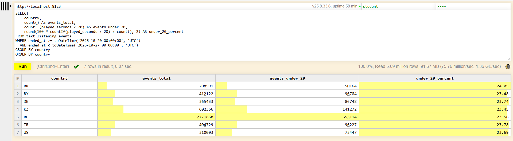

### 1.2 Небольшой контроль

#### SQL запрос
```
SELECT
    country,
    count() AS events_total,
    countIf(played_seconds < 20) AS events_under_20,
    round(100 * countIf(played_seconds < 20) / count(), 2) AS under_20_percent
FROM
values(
 'ended_at DateTime(\'UTC\'), country String,
 user_id UInt64, played_seconds UInt32',
 ('2026-10-19 23:59:59', 'RU', 101, 5),
 ('2026-10-20 00:00:00', 'RU', 101, 19),
 ('2026-10-22 12:00:00', 'RU', 101, 20),
 ('2026-10-26 23:59:59', 'RU', 102, 21),
 ('2026-10-27 00:00:00', 'RU', 103, 1),
 ('2026-10-21 10:00:00', 'KZ', 201, 5),
 ('2026-10-21 10:01:00', 'KZ', 201, 20)
)
WHERE ended_at >= toDateTime('2026-10-20 00:00:00', 'UTC')
  AND ended_at < toDateTime('2026-10-27 00:00:00', 'UTC')
GROUP BY country
ORDER BY country;
```

#### Расчет вручную
```
values(
 'ended_at DateTime(\'UTC\'), country String,
 user_id UInt64, played_seconds UInt32',
 ('2026-10-19 23:59:59', 'RU', 101, 5),
 ('2026-10-20 00:00:00', 'RU', 101, 19),
 ('2026-10-22 12:00:00', 'RU', 101, 20),
 ('2026-10-26 23:59:59', 'RU', 102, 21),
 ('2026-10-27 00:00:00', 'RU', 103, 1),
 ('2026-10-21 10:00:00', 'KZ', 201, 5),
 ('2026-10-21 10:01:00', 'KZ', 201, 20)
)
```

**Для RU:**
events_total = 3
подходящие под фильтр события:

```
 ('2026-10-20 00:00:00', 'RU', 101, 19),
 ('2026-10-22 12:00:00', 'RU', 101, 20),
 ('2026-10-26 23:59:59', 'RU', 102, 21),
```

events_under_20 = 1

```
 ('2026-10-20 00:00:00', 'RU', 101, 19)
```

under_20_percent = round(100 * 1 / 3, 2) = 33.33

**Для KZ:**
events_total = 2
подходящие под фильтр события:
```
 ('2026-10-21 10:00:00', 'KZ', 201, 5),
 ('2026-10-21 10:01:00', 'KZ', 201, 20)
```

events_under_20 = 1

```
 ('2026-10-21 10:00:00', 'KZ', 201, 5),
```

under_20_percent = round(100 * 1 / 2, 2) = 50

#### Результат SQL запроса  
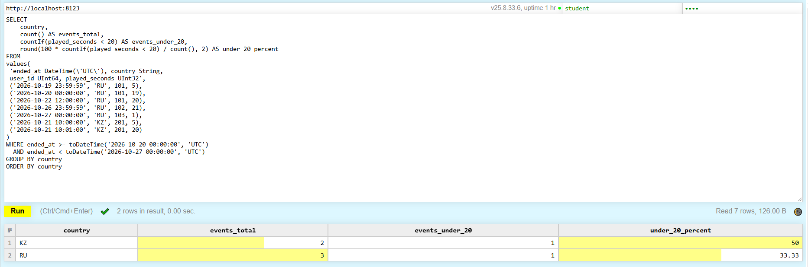

#### Сопоставление

Результаты совпадают: RU (3, 1, 33.33), KZ (2, 1, 50)

### 1.3 Ответы на вопросы

> Выберите одну страну из отчёта по основному набору. На полученных числах объясните смысл рассчитанного процента.

Рассмотрим Бразилию (BR)

events_total = 208591  
events_under_20 = 50164  
under_20_percent = 24.05  

Можно интерпретировать как `Каждое четвертое прослушивание заканчивалось менее чем через 20 секунд после старта трека`  

Этот процент показывает нам именно долю прослушиваний и помогает найти какую-то общую аномалию по стране вне зависимости от слушателей. Ведь несколько коротких прослушиваний одного пользователя увеличивают долю.

> Почему доля событий с длительностью меньше 20 секунд не обязательно равна доле слушателей, у которых за период было хотя бы одно такое прослушивание? Покажите различие на строках KZ из небольшого примера

В первом случае пользователь с множеством прослушиваний длительностью менее 20 секунд каждым таким прослушиванием вносит вклад в долю и увеличивает её. В доле же слушателей количество коротких прослушиваний не учитывается, важен только факт наличия такого прослушивания.  

Пример KZ:
```
 ('2026-10-21 10:00:00', 'KZ', 201, 5),
 ('2026-10-21 10:01:00', 'KZ', 201, 20)
```

 Здесь доля слушателей = 100%, при этом доля коротких прослушиваний = 50%

## 2. Ключ сортировки

### 2.1 Подготовка
SQL-скрипт сохранен в файле [02_order_by.sql](02_order_by.sql)  

Проверка parts:  
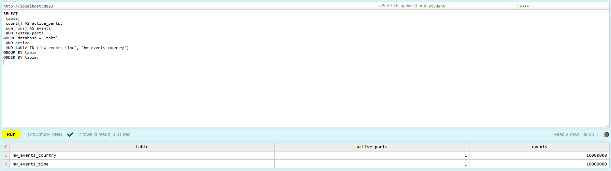

Проверка ключей:  
```
SHOW CREATE TABLE takt.hw_events_time;
SHOW CREATE TABLE takt.hw_events_country;
```

```
CREATE TABLE takt.hw_events_time
(
    `ended_at` DateTime('UTC') CODEC(Delta(4), ZSTD(1)),
    `user_id` UInt64,
    `track_id` UInt64,
    `country` String,
    `platform` String,
    `app_version` String,
    `played_seconds` UInt32,
    `track_seconds` UInt32
)
ENGINE = MergeTree
ORDER BY ended_at
SETTINGS index_granularity = 8192, index_granularity_bytes = 0  


CREATE TABLE takt.hw_events_country
(
    `ended_at` DateTime('UTC') CODEC(Delta(4), ZSTD(1)),
    `user_id` UInt64,
    `track_id` UInt64,
    `country` String,
    `platform` String,
    `app_version` String,
    `played_seconds` UInt32,
    `track_seconds` UInt32
)
ENGINE = MergeTree
ORDER BY (country, ended_at)
SETTINGS index_granularity = 8192, index_granularity_bytes = 0
```

### 2.2 Таблица измерений
Проверка ответов по запросам:
- ответы по Германии совпадают между таблицами (59423 / 14833 / 24.96)
- ответы по всем странам совпадают между таблицами
- результаты по DE в общем отчёте совпадает с отдельным отчётом по Германии

Результаты проверки можно увидеть на скриншотах в таблице (SQL + ответ)

Гипотеза о влиянии составного ключа перед запуском: составной ключ позволит эффективно получать аналитику по конкретной стране, за счет того, что будут прочитанны только нужные строки. Но для запроса по всем странам запрос будет менее эффективен, так как придется собирать несколько диапазонов.


| Запрос | Ключ таблицы | Granules: x/y | Прочитано строк | Прочитано байт | SQL, ответ и план |
|---|---|---|---|---|---|
| Германия | (ended_at) | 102/1221 | Read 835.58 thousand rows | 15.04 MB | SQL + ответ 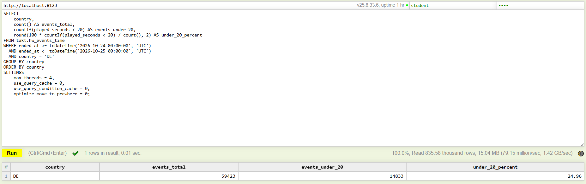 <br> План 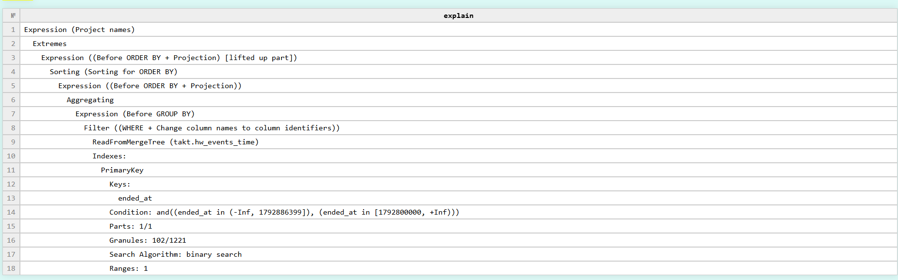 |
| Германия | (country, ended_at) | 8/1221 | Read 65.54 thousand rows | 1.18 MB | SQL + ответ 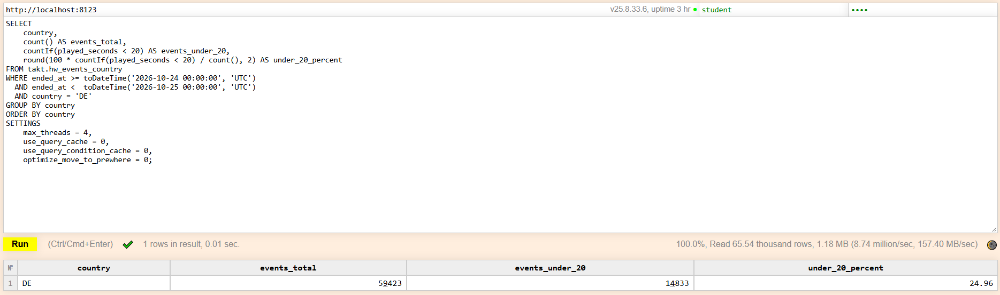 <br> План 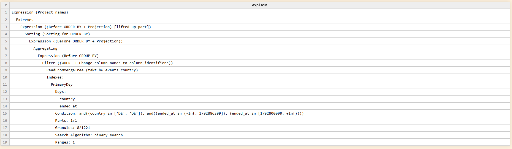 |
| Все страны | (ended_at) | 102/1221 | Read 835.58 thousand rows | 15.04 MB | SQL + ответ 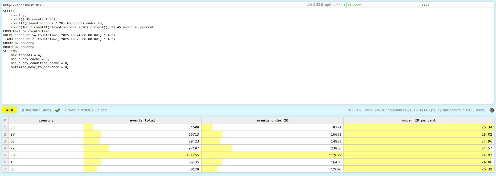 <br> План 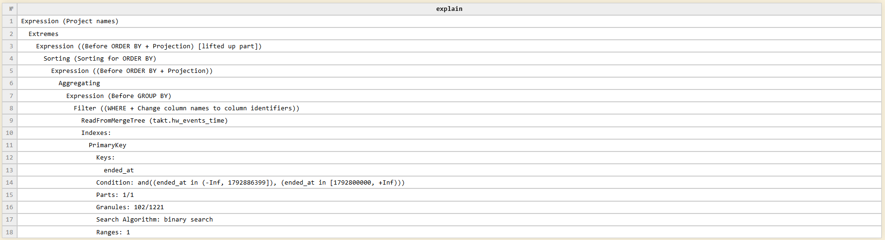 |
| Все страны | (country, ended_at) | 114/1221 | Read 931.46 thousand rows | 16.77 MB | SQL + ответ 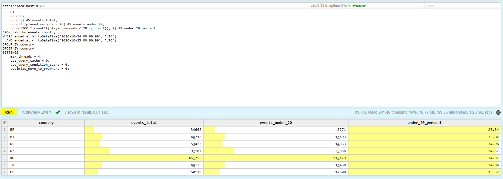 <br> План 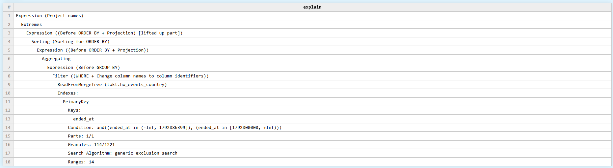 |

### 2.3 Ответы на вопросы

> Для каждого варианта сравните прочитанные строки и выбранные гранулы между таблицами. Приведите числа. Если различия нет или округление не позволяет его установить, так и напишите.

Для запроса по Германии ключ сортировки (ended_at) использует 102/1221 гранулы и читает 835.58к строк, ключ же (country, ended_at) использует 8/1221 гранулы и читает 65.54к строк. Для поиска по конкретной стране ключ (country, ended_at) эффективен.

Для запроса по всем странам ключ сортировки (ended_at) использует 102/1221 гранулы (как и для запроса по конкретной стране) и читает 835.58к строк, ключ (country, ended_at) использует 114/1221 гранулы и читает 931.46к строк. Для получения статистики по всем странам за конкретный период ключ (country, ended_at) оказывается менее эффективен, чем (ended_at)

> Объясните, как расположены события при каждом порядке хранения и как условия двух запросов связаны с отбором гранул. Опирайтесь на планы.

**Расположение событий**

В hw_events_time с ключом сортировки `ended_at` события упорядочены только по времени. Любой промежуток времени, например с 24 числа по 25 число, это последовательный участок гранул  

В hw_events_country с ключом сортировки `(country, ended_at)` таблица разбита на сегменты по странам, внутри которых события упорядочены по времени  

Визуальное представления хранения на рисунке ниже: слева hw_events_time, справа hw_events_country  
(выделен поиск по заданному периоду без указания страны)  
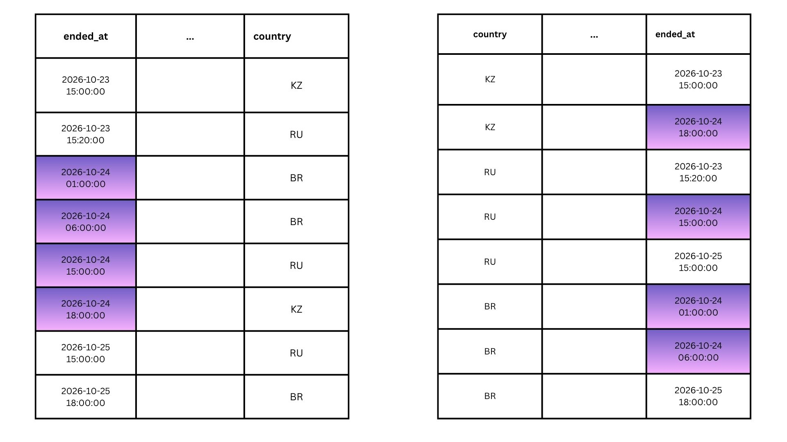

**Связь условий запросов с отбором гранул**

При запросе по Германии за указанный период:  
1. По таблице hw_events_time отбираются все гранулы, входящие в период (Condition по ended_at) - это будет непрерывная последовательность гранул. По плану видим Ranges: 1. Далее к прочитанным строкам применяется фильтрация по country = 'DE'
2. По плану запроса к hw_events_country Condition содержит уже и `country in ['DE','DE']`, и диапазон ended_at. По индексу нужный участок гранул находится сразу, оба поля есть в нем. Это также подтверждает `Ranges: 1` в плане запроса. 

При запросе по всем странам за указанный период:
1. Аналогично запросу по конкретной стране, только без фильтрации. Видим в плане `Condition: ended_at`, по индексу отбирается непрерывный участок гранул. `Ranges: 1`.
2. Для hw_events_country по плану видим `Condition: ended_at` - country не используется при этом запросе. Так как в запросе участвует только вторая колонка из ключа сортировки, одним участком гранул прочитать все строки не получится, поэтому выбирается несколько диапазонов. По плану видим `Ranges: 14`. Отсюда и выходит, что прочитанных строк в итоге больше.


> На hw_events_time сравните «Германию» и «Все страны»: количество подходящих событий - значение или сумма events_total - и прочитанные строки. Почему меньше подходящих событий не обязательно означает меньше чтения? Различите подходящие события, прочитанные строки и строки итогового отчёта.  

**hw_events_time «Германия»:**  
количество подходящих событий = 59423  
прочитанные строки = 835.58к  

**hw_events_time «Все страны»:**
количество подходящих событий = 825369  
прочитанные строки = 835.58к    

Меньше подходящих событий не означает меньше чтения, так как гранулы в обоих случаях отбираются только по ended_at, а фильтр/группировка по country применяется к уже прочитанным строкам  

Подходящие события - события, которые прошли фильтрацию  
Прочитанные строки - строки выбранных гранул  
Строки итогового отчета - то, что мы получаем на выходе. В нашем случае - группировка по странам.

> Выберите ключ для каждого из двух исследованных запросов по объёму чтения в этом опыте. Каких сведений не хватает для выбора одного ключа для всей нагрузки сервиса?

Для запроса по конкретным странам выбираем ключ (country, ended_at)  
Для запроса по всем странам выбираем ключ (ended_at)  
Для того, чтобы выбрать один ключ для всей нагрузки сервиса не хватает профиля нагрузки сервиса: запросы с какими фильтрами и как часто обычно выполняются в сервисе.

## 3. Кодеки
### 3.1 Подготовка таблица и проверка

Скрипт с подготовкой: [03_codecs.sql](03_codecs.sql)

Результаты проверки  

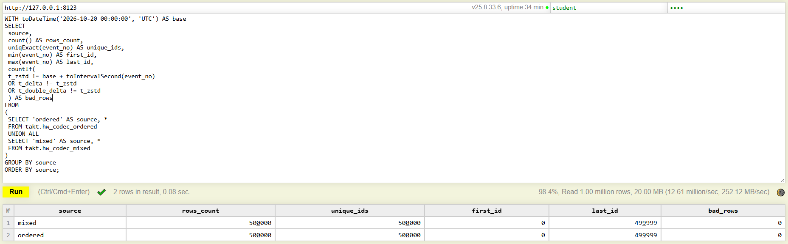  


### 3.2 Исследование соседних значений

**hw_codec_mixed**:

| № | event_no | t_zstd | seconds_from_start |
|---|---|---|---|
| 1 | 36993 | 2026-10-20 10:16:33 | 36993 |
| 2 | 222135 | 2026-10-22 13:42:15 | 222135 |
| 3 | 480696 | 2026-10-25 13:31:36 | 480696 |
| 4 | 440268 | 2026-10-25 02:17:48 | 440268 |
| 5 | 486310 | 2026-10-25 15:05:10 | 486310 |
| 6 | 296535 | 2026-10-23 10:22:15 | 296535 |

**hw_codec_ordered**:

| № | event_no | t_zstd | seconds_from_start |
|---|---|---|---|
| 1 | 0 | 2026-10-20 00:00:00 | 0 |
| 2 | 1 | 2026-10-20 00:00:01 | 1 |
| 3 | 2 | 2026-10-20 00:00:02 | 2 |
| 4 | 3 | 2026-10-20 00:00:03 | 3 |
| 5 | 4 | 2026-10-20 00:00:04 | 4 |
| 6 | 5 | 2026-10-20 00:00:05 | 5 |

**Таблица разностей hw_codec_mixed**
| № | seconds_from_start | 1-я разность | 2-я разность |
|---|---|---|---|
| 1 | 36993 | 185142 | 73419 |
| 2 | 222135 | 258561 | -298989 |
| 3 | 480696 | -40428 | 86470 |
| 4 | 440268 | 46042 | -235817 |
| 5 | 486310 | -189775 | - |
| 6 | 296535 | - | - |

Закономерности не наблюдается, разности находятся в случайном порядке.

**Таблица разностей hw_codec_ordered**
| № | seconds_from_start | 1-я разность | 2-я разность |
|---|---|---|---|
| 1 | 0 | 1 | 0 |
| 2 | 1 | 1 | 0 |
| 3 | 2 | 1 | 0 |
| 4 | 3 | 1 | 0 |
| 5 | 4 | 1 | - |
| 6 | 5 | - | - |

Есть явная закономерность: 1-я разность всегда равна 1, 2-я разность всегда 0. seconds_from_start - это непрерывная последовательность чисел, начиная с 0.

**Пример восстановление**  

На примере таблицы hw_codec_mixed, начиная со 2-й разности покажу процесс восстановления.  
Пусть известно, что начальное значение искомой последовательности a1, a1 = 36993 и d (1-разность) d1 = 185142

Тогда 
a1 = 36993;  
a2 = a1 + d1 = 222135;  
d2 = d1 + dd1 = 185142 + 73419 = 258561;  
a3 = a2 + d2 = 222135 + 258561 = 480696

### 3.3 Измерение размеров колонок

Предположение до замеров: 
В таблице hw_codec_ordered DoubleDelta + ZSTD < Delta + ZSTD < ZSTD - так как DoubleDelta нужно будет два начальных значения + все двойные разности будут нулями. 
В перемешанной таблице закономерности между значениями нет, её не будет в разностях, поэтому скорее всего результат между 3 цепочками будет схож для этой таблицы.

| № | table | column | uncompressed_bytes | compressed_bytes | compression_ratio |
|---|---|---|---|---|---|
| 1 | hw_codec_mixed | t_delta | 2000000 | 1586160 | 1.26 |
| 2 | hw_codec_mixed | t_double_delta | 2000000 | 1962850 | 1.02 |
| 3 | hw_codec_mixed | t_zstd | 2000000 | 1543831 | 1.3 |
| 4 | hw_codec_ordered | t_delta | 2000000 | 2234 | 895.26 |
| 5 | hw_codec_ordered | t_double_delta | 2000000 | 2325 | 860.22 |
| 6 | hw_codec_ordered | t_zstd | 2000000 | 1332284 | 1.5 |


### 3.4 Ответы на вопросы  

> Сравните три цепочки внутри каждого порядка. Какая дала минимальный сжатый размер в регулярной таблице, какая - в перемешанной? Приведите числа. Равенство допускается.  

Для регулярной таблицы лучший результат показал кодек Delta + ZSTD, в таком формате колонка занимает 2234 байта
Для смешанной таблицы лучший результат показало только сжатие ZSTD без использования кодека, в таком формате колонка занимает 1543831 байт  

Для регулярной таблицы схожими оказались результаты Delta + ZSTD и DoubleDelta + ZSTD - разница составила всего 91 байт  

Для перемешанной таблицы Delta + ZSTD и просто ZSTD показали сравнимый результат.  

В целом для двух таблиц просто ZSTD показал схожий коэффициент сжатия 1.3 у перемешанной и 1.5 у регулярной

> Для одной выбранной цепочки сравните два порядка. Свяжите изменение размера с соседством значений и рассчитанными разностями.  

Сравним hw_codec_mixed (Delta + ZSTD) и hw_codec_ordered (Delta + ZSTD):  

В первом случае, так как в таблице значения расположены в перемешанном порядке, закономерность после применения Delta не выделяется. Это сказывается на сжатии ZSTD - алгоритм хорошо справляется с повторяющимися данными, там, где есть некоторая закономерность. Поэтому результат сжатия довольно слабый  

Во втором случае, благодаря Delta колонка кодируется как изначальное значение и все разности это единицы, так как значения строго последовательные. За счет этого есть явная закономерность и для ZSTD это очень подходящие данные. Получаем большую эффективность сжатия.

На примере рассчитанных данных  
в ordered первые разности - все 1 (из таблицы 3.2), в mixed: 185142, 258561, -40428 и т.д; так и выходит 2234б против 1586160б

> Чем отличаются Delta и DoubleDelta, какую работу после них выполняет ZSTD? Почему дополнительные преобразования не гарантируют меньший итоговый размер? Опора - раздел 2 лонгрида и описание кодеков

Кодек Delta представляет значения колонки как одно начальное значение и разности между следующим элементом и предыдущем.  

Кодек DoubleDelta применяет к Delta ещё разность - получается разность разностей. Особенно эффективно, когда разности маленькие и часто повторяются.

ZSTD уже смотрит на значения как на последовательность байт и сжимает именно последовательность байт, на основе поиска повторов в ней. Именно по причине того, что ZSTD работает с байтами, дополнительные преобразования не гарантируют меньший итоговый размер. Там, где на уровне значений мы видим явную закономерность, для алгоритма ZSTD эта закономерность может оказаться менее удобной и практичной.

> Почему порядок хранения реальной таблицы сервиса нельзя выбирать только по минимальному сжатому размеру? Свяжите ответ с заданием 2.

Таблица, которая лучше сжимается, может вычитывать больше строк при конкретном профиле запросов и тратить на декодирование больше ресурсов. Нужно учитывать профиль нагрузки системы и выбирать баланс.  

На примере из задания 2. Таблица с ключом только по времени может эффективно сжиматься, однако если запросы аналитики по конкретной стране происходят в разы чаще, то выгода от малого потребления дискового пространства может быть в разы меньше, чем от быстрого выполнения запроса.


Отдельно объясните сохранение информации:
```
В реальном сервисе исходные времена событий хранятся с такой цепочкой кодеков. Можно ли точно
посчитать события за новый интервал, например с 10:15 до 10:45 определённого дня? Что изменится,
если вместо времён событий сохранить только количества за каждый день?
```

> В реальном сервисе исходные времена событий хранятся с такой цепочкой кодеков. Можно ли точно посчитать события за новый интервал, например с 10:15 до 10:45 определённого дня?  

События можно посчитать точно, так как любая из рассмотренных цепочек в задании использует ZSTD - алгоритм сжатия без потерь. Преобразования не всегда эффективны, но данные останутся целыми.

> Что изменится, если вместо времён событий сохранить только количества за каждый день?   

Мы потеряем возможность смотреть данные не за целый день, а за промежуток, например, с середины одного дня по середину другого. То есть мы теряем возможность анализа данных на промежутках, не кратных суткам.  
